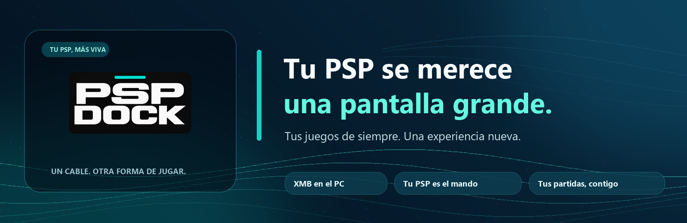

<div align="center">
  

  ### La PSP que recuerdas. Una forma nueva de jugar.

  **[🖥️ Descargar para Windows](https://github.com/jalinhabrava/Psp-dock/releases/latest/download/PSP-Dock-Windows-v0.1.2.exe)** · **[🎮 Descargar para PSP](https://github.com/jalinhabrava/Psp-dock/releases/latest/download/PSP-Dock-PSP-v0.1.2.zip)**

  [Ver todas las versiones](https://github.com/jalinhabrava/Psp-dock/releases) · [Cómo funciona](#empieza-a-jugar)

  [English](README.md) · **Español**
</div>

---

## Tu PSP todavía tiene muchas partidas por delante 💙

¿Te acuerdas de llevar tu PSP a todas partes? **PSP Dock nació para que no tengas que elegir entre disfrutar de aquella consola y jugar cómodamente en una pantalla grande.**

Conecta tu PSP al ordenador, abre **PSP Dock** y vuelve a encontrarte con tu biblioteca en un menú inspirado en el XMB que tanto nos gusta. La consola sigue siendo tu mando; el PC pone la pantalla, la potencia y el emulador. Y cuando terminas, tus partidas pueden volver contigo a la PSP.

**Sin dejar un programa ejecutándose todo el día. Sin copiar tu biblioteca desde cero cada vez. Y sin perder ese toque de la PSP original.**

**Un único programa, en tu idioma.** PSP Dock incluye inglés y español en el mismo ejecutable de Windows y el mismo EBOOT de PSP: el idioma se detecta automáticamente y en Windows también puedes cambiarlo desde Ajustes.

## Lo mejor de los dos mundos

| | |
|---|---|
| 🎮 **Tu PSP sigue al mando** | Navega por el menú y juega utilizando los botones y el joystick de la propia consola. |
| 🖥️ **Tus juegos, en grande** | Elige un título en PSP Dock y disfruta en el PC a través de PPSSPP, sin renunciar al control original. |
| 💾 **Tus partidas van contigo** | PSP Dock compara los guardados, te pide permiso para las copias y ayuda a devolver los cambios al terminar. |
| ✨ **Un menú con alma de PSP** | Categorías deslizantes, carátulas, fondos y los pequeños sonidos del XMB cuando tu consola es compatible. |
| ⚡ **Recuerda tu biblioteca** | La siguiente conexión es mucho más rápida: no vuelve a leer por completo los juegos que siguen igual. |
| 🕹️ **También pensamos en lo retro** | Hay integración inicial con emuladores de otras consolas y opciones de mejora visual que seguimos desarrollando. |

## Empieza a jugar

<table>
  <tr>
    <th>En tu ordenador</th>
    <th>En tu PSP</th>
  </tr>
  <tr>
    <td>
      <strong>1. Descarga PSP Dock para Windows</strong><br>
      Abre el ejecutable y prepara tu biblioteca. No necesitas instalar Python.
    </td>
    <td>
      <strong>2. Descarga PSP Dock para PSP</strong><br>
      Copia la carpeta <code>PSP/GAME/PSPDockNative/</code> del ZIP a la raíz de tu Memory Stick. [Guía paso a paso](INSTALL.es.md).
    </td>
  </tr>
</table>

**3. Une los dos mundos.** Abre PSP Dock en Windows y en la PSP, conecta el cable USB y sigue las indicaciones de la pantalla. Elige qué copiar, disfruta de tus juegos y, cuando acabes, deja que se comprueben tus partidas antes de desconectar.

<div align="center">

  **[⬇️ Ir a las descargas](https://github.com/jalinhabrava/Psp-dock/releases/latest)**

</div>

> **Antes de empezar:** necesitarás una PSP con homebrew compatible, un cable USB y tu propia copia de PPSSPP para Windows. La experiencia actual se ha probado principalmente con una PSP-2003 con firmware 6.61/ARK-5. PSP Dock no incluye juegos, BIOS, emuladores de terceros ni archivos de firmware de Sony. El ejecutable de Windows aún no está firmado digitalmente; comprueba su origen y el SHA-256 publicado. Si ya tienes una versión antigua de PSP Dock en la Memory Stick, haz una copia de seguridad y consulta la [guía de instalación](INSTALL.es.md): **no sobrescribas la carpeta anterior sin revisarla**.

## Un proyecto que sigue creciendo 🌱

Este es nuestro **primer lanzamiento para Windows**, pero las ideas no se acaban aquí: compatibilidad con más emuladores, texturas HD, una experiencia para Android TV y una versión para Linux están entre los caminos que estamos explorando.

Los proyectos de Android TV, Linux y el motor experimental de texturas **todavía no forman parte de las descargas listas para jugar**. Preferimos enseñarte cómo avanzan a prometer que todo funciona ya en cualquier dispositivo.

## Creado para los que seguimos queriendo a la PSP

PSP Dock es un proyecto de comunidad y una pequeña declaración de amor a una consola que se merece seguir encendida. Si lo pruebas, encuentras un fallo o se te ocurre una mejora, tu experiencia será bienvenida en [Issues](https://github.com/jalinhabrava/Psp-dock/issues).

**Hecho por [@jalinhabrava](https://github.com/jalinhabrava).** Puedes usar, estudiar y compartir el código original para fines no comerciales, manteniendo el crédito y los términos de [PolyForm Noncommercial 1.0.0](LICENSE.md). Las partes derivadas de FuSa GAMEPAD conservan **GPL-3.0**, que permite usos comerciales bajo sus propias condiciones. Detalles en [NOTICE](NOTICE.md) y [licencias de terceros](THIRD_PARTY_NOTICES.md).

<details>
<summary><strong>Para quienes quieran mirar bajo el capó 🔧</strong></summary>

### Compatibilidad y seguridad

- **Windows**: versión principal con interfaz XMB y conexión con homebrew PSP Dock nativo **0308** (protocolo PDK2/v3).
- **PSP**: instala el contenido completo del ZIP de PSP: el `EBOOT.PBP` necesita estar acompañado por `docknative.prx` y sus avisos de licencia en la misma carpeta. No modifiques flash ni plugins de ARK para instalar este paquete.
- **PPSSPP**: se configura o instala por separado. PSP Dock no distribuye su ejecutable ni contenidos de juegos.
- **Guardados**: antes de copiar, revisa los conflictos y mantén conectado el cable durante la comprobación. Haz siempre una copia de seguridad de tus partidas importantes.
- **Linux y Android TV**: prototipos en desarrollo; todavía no están disponibles como versiones probadas.

### Desarrollar o probar

El host está escrito principalmente en Python y utiliza HTML/CSS/JavaScript para el menú. La app de PSP se compila con PSPDEV. El código también incorpora herramientas experimentales de investigación de texturas.

```shell
python -m unittest tests.test_device_memory tests.test_dock_product_session tests.test_native_dock -q
node --test "tests/*.test.js"
```

La prueba de movimiento del XMB utiliza un navegador Chromium real, una biblioteca de demostración aislada y **no accede a la PSP**.

Puedes consultar el [protocolo y homebrew](homebrew/native-dock/README.md), el [historial del proyecto](CHANGELOG.es.md) y las [notas de investigación HD](docs/MOTOR-TEXTURAS-DETERMINISTA.md).

</details>

<div align="center">

  <sub>PSP Dock no está afiliado a Sony, PlayStation, PPSSPP ni RetroArch. Las marcas pertenecen a sus respectivos propietarios.</sub>

</div>
