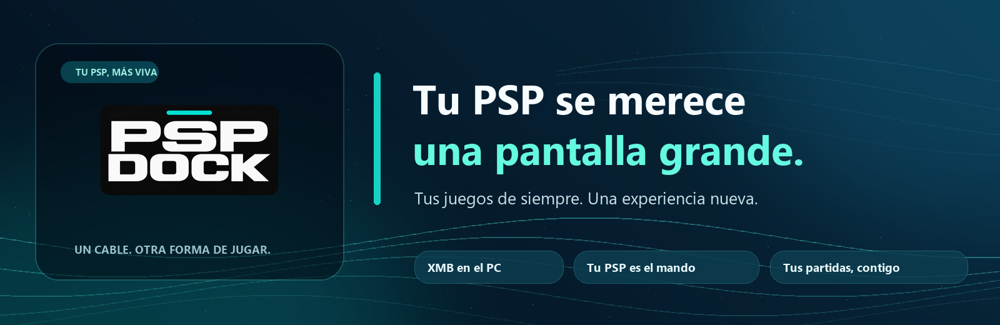

<div align="center">
  

  ### The PSP you remember. A whole new way to play.

  **[🖥️ Download for Windows](https://github.com/jalinhabrava/Psp-dock/releases/latest/download/PSP-Dock-Windows-v0.1.3.exe)** · **[🎮 Download for PSP](https://github.com/jalinhabrava/Psp-dock/releases/download/v0.1.2/PSP-Dock-PSP-v0.1.2.zip)**

  [All releases](https://github.com/jalinhabrava/Psp-dock/releases) · [Getting started](#lets-play)

  **English** · [Español](README.es.md)
</div>

---

## Your PSP still has adventures waiting. 💙

Remember taking your PSP everywhere? **PSP Dock brings that feeling back — only now your favorite handheld can take over the big screen, too.**

Connect your PSP to a Windows PC, launch **PSP Dock**, and rediscover your games in a familiar XMB-style menu. Your actual PSP becomes your controller. Your PC handles the screen and PPSSPP. And when you're finished, your compatible save files can travel back to your handheld.

**No background service running all day. No copying every game again on every connection. Just your PSP, with a little more room to play.**

## The best of both worlds

| | |
|---|---|
| 🎮 **Your PSP is the controller** | Browse your library and play with the buttons and analog stick you already love. |
| 🖥️ **Your games, bigger** | Pick a game in PSP Dock and run it with PPSSPP on your Windows PC. |
| 💾 **Keep your progress close** | Compare saves, review conflicts, and sync changes back with your approval. |
| ✨ **It still feels like PSP** | Smooth XMB navigation, game art, backgrounds, and original menu sounds when supported. |
| ⚡ **Your library, remembered** | Reconnect without re-reading every unchanged game from your Memory Stick. |
| 🕹️ **More than PSP** | Recognized retro emulators can get their approved Windows equivalents in the background, with a progress indicator right in the XMB. |

## Let's play

<table>
  <tr>
    <th>On your Windows PC</th>
    <th>On your PSP</th>
  </tr>
  <tr>
    <td>
      <strong>1. Get PSP Dock for Windows</strong><br>
      Download the portable executable. No Python installation required.
    </td>
    <td>
      <strong>2. Get PSP Dock for PSP</strong><br>
      Install the complete <code>PSP/GAME/PSPDockNative/</code> folder from the ZIP on your Memory Stick. <a href="INSTALL.md">Step-by-step guide</a>.
    </td>
  </tr>
</table>

**3. Bring them together.** Open PSP Dock on your PC and your handheld, connect them with USB, and follow the on-screen guide. Choose what to copy, start playing, and let your saves finish syncing before you disconnect.

**Got retro emulators on your PSP?** You'll find them in the XMB, too. Choose an emulator to open its ROM list on the right. PSP Dock can prepare RetroArch and the compatible cores **on Windows, in the background** — no extra USB mode switch for installing software. Once a ROM and its core are ready on the PC, select it to play. Transferring a ROM that is missing on your PC is a separate, explicit step.

<div align="center">

  **[⬇️ Get the latest release](https://github.com/jalinhabrava/Psp-dock/releases/latest)**

</div>

### One download, your language

**English and Spanish are included in the same Windows and PSP builds.** Windows follows your browser/UI language, while the PSP follows the language selected in its system settings. You can also choose a language inside PSP Dock on Windows. **No separate English or Spanish executable is needed.**

> **Before you start:** You need a homebrew-capable PSP, a USB cable, and your own copy of PPSSPP for Windows. Development and real-device testing have focused on a PSP-2003 running firmware 6.61/ARK-5. PSP Dock does **not** include games, BIOS files, other emulators, or Sony firmware. The Windows executable is currently unsigned; download it from this repository and check the published SHA-256. Already have PSP Dock installed on your handheld? Back up your saves and follow the [upgrade instructions](INSTALL.md) rather than overwriting the previous files blindly.

## There's more to come 🌱

This is our first Windows-focused release, not the end of the story. We're exploring more retro systems, HD texture enhancements, Android TV, and Linux support.

Those platforms and experimental features are **not yet ready-to-play downloads**. We'd rather show the real progress than promise something that isn't tested.

## Made for people who still love the PSP

PSP Dock is a community-minded passion project and a little love letter to one of the greatest handhelds ever made. Found a bug? Have a brilliant idea? We'd love to hear from you in [Issues](https://github.com/jalinhabrava/Psp-dock/issues).

**Made by [@jalinhabrava](https://github.com/jalinhabrava).** The original code is available for noncommercial use, study, modification, and sharing under [PolyForm Noncommercial 1.0.0](LICENSE.md), with attribution required. Components derived from FuSa GAMEPAD retain their **GPL-3.0** terms, including their own commercial-use permissions. See [NOTICE](NOTICE.md) and [third-party licenses](THIRD_PARTY_NOTICES.md).

<details>
<summary><strong>Under the hood 🔧</strong></summary>

### Compatibility and safety

- **Windows:** The main release uses the XMB launcher and native PSP Dock **0308** homebrew (PDK2/v3).
- **PSP:** Install the entire PSP ZIP. `EBOOT.PBP` needs `docknative.prx` alongside it. No PSP flash modification or ARK plugin installation is required.
- **PPSSPP:** Set up your own copy separately. PSP Dock does not redistribute PPSSPP executables or game content.
- **Saves:** Always back up precious progress and review conflicts before copying; keep the cable connected throughout verification.
- **Other platforms:** Linux and Android TV are still experimental and not validated release downloads.

### Building and testing

The Windows host is written mainly in Python, with HTML/CSS/JavaScript for the interface. The PSP app is built with PSPDEV. The repository also includes experiments in deterministic PSP texture handling.

```shell
python -m unittest tests.test_device_memory tests.test_dock_product_session tests.test_native_dock -q
node --test "tests/*.test.js"
```

The XMB animation test uses a real Chromium browser and a synthetic game library. It **never accesses a real PSP**.

Read about the [Python project structure](docs/PROJECT-STRUCTURE.md), [native homebrew](homebrew/native-dock/README.md), see the [changelog](CHANGELOG.md), or explore the [HD texture research](docs/MOTOR-TEXTURAS-DETERMINISTA.md).

</details>

<div align="center">

  <sub>PSP Dock is an independent project, not affiliated with or endorsed by Sony, PlayStation, PPSSPP, or RetroArch. All trademarks belong to their owners.</sub>

</div>
