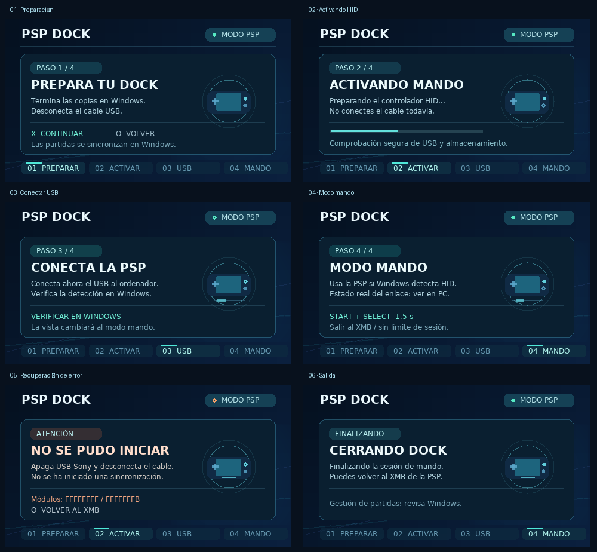

# PSP Dock · nueva interfaz del homebrew para PSP

**Alcance:** solo `homebrew/psp-dock-app` (cliente HID permanente). No se
modifican los módulos kernel, el protocolo HID, la FAT ni la sincronización
con Windows. Se deja el piloto USB compuesto separado y desactivado.



## Qué ve el usuario

El XMB ahora incorpora `ICON0.PNG` (144×80), `PIC0.PNG` (310×180) y
`PIC1.PNG` (480×272), generados de forma reproducible sin usar material
gráfico de otros juegos. La app ya no muestra `pspDebugScreenPrintf`: usa un
renderer ABGR8888 nativo de 480×272 con doble buffer y una tipografía bitmap
legible para LCD. El fondo permanece activo durante la sesión con ondas
sutiles, indicadores y una visualización local de botones, aproximadamente
a 3 FPS para limitar consumo de CPU.

1. **Preparar:** recuerda que las copias/partidas se gestionan primero desde
   Windows. Solicita quitar el cable y permite ✕ continuar u ○ cancelar.
2. **Activar:** carga los mismos dos módulos que antes y espera cuatro segundos
   antes de invitar a conectar USB, respetando la comprobación de 1,5 segundos
   que ejecuta el kernel. La barra refleja ese margen de espera, **no** una
   sincronización o una comprobación confirmada por el kernel.
3. **Conectar:** muestra instrucciones claras para conectar el cable y
   comprobar la detección HID en el PC. No afirma una conexión verificada.
4. **Mando:** tras unos segundos de guía cambia solo la vista, sin exigir una
   segunda pulsación de ✕ que también se enviaría a Windows. Se mantiene
   hasta START+SELECT durante 1,5 segundos; desconectar el cable detiene el
   HID en kernel igual que antes. La pantalla no se apaga.
5. **Error:** muestra causas probables e identificadores de error de módulos;
   ○ sale al XMB. No hay reintento automático ni cambios de rol USB.
6. **Salida:** informa de la finalización y conserva el margen de tres segundos
   de cierre cuando el usuario sale manteniendo START+SELECT.

**Limitación importante:** el EBOOT USER no tiene imports directos USB ni
acceso al estado de sincronización del PC. El componente BULK/ACK de ida y
vuelta todavía no funciona en hardware; por eso no se muestran porcentajes
inventados de juegos, partidas, transferencias o detección USB. La UI puede
presentar la vista de mando aunque el PC no haya enumerado el dispositivo;
el texto advierte expresamente que debe verificarse en Windows.

## Construcción y pruebas

Con PSPDEV preinstalado en WSL:

```bash
bash homebrew/psp-dock-app/build-wsl.sh
```

La compilación ejecuta antes los tests C del renderer y al final valida
las secciones XMB/PNG del PBP. También comprueba que el EBOOT USER no ha
importado interfaces USB ni kernel y que el PRX conserva sus guardas
revisadas de salida/cable. Para generar nuevos gráficos y una previsualización:

```bash
python3 homebrew/psp-dock-app/assets/generate_artwork.py
python3 homebrew/psp-dock-app/assets/generate_font.py
gcc -std=c99 -Wall -Wextra -Werror -Ihomebrew/psp-dock-app \
    homebrew/psp-dock-app/ui.c \
    homebrew/psp-dock-app/tests/test_ui_renderer.c -o /tmp/psp-ui-test
mkdir -p /tmp/psp-ui-frames
/tmp/psp-ui-test /tmp/psp-ui-frames
python3 homebrew/psp-dock-app/assets/render_preview.py \
    /tmp/psp-ui-frames docs/psp-homebrew-ui-preview.png
```

Los scripts de generación requieren Pillow y una instalación local de
DejaVu Sans. La PSP **no necesita** ni Pillow ni archivos TTF. Se distribuye
solo la representación bitmap del alfabeto; licencia en
`homebrew/psp-dock-app/assets/LICENSE-DejaVu.txt`.

## Prueba en PSP real pendiente

El PBP se compila **solo en PC**, no se instala de forma automática. Antes de
reemplazar la carpeta `PSP/GAME/PSPDock`, aplicar el procedimiento actual de
identificación de volumen Sony, backup y verificación de hashes; conservar
una copia del EBOOT anterior para rollback y no tocar plugins ARK ni SAVEDATA.

Prueba sugerida: arrancar sin cable, verificar que las seis vistas (incluido
error con módulo ausente en una instalación de laboratorio) son legibles,
salir con ○, cargar HID, esperar hasta el aviso de conectar, enumerar en
Windows, comprobar todos los controles en el XMB/PPSSPP, retirar el cable,
mantener START+SELECT y volver al XMB. Verificar que no hubo bloqueo de
USBSTOR ni escritura indebida. Si la pantalla no aparece, restaurar EBOOT
anterior y no hacer ensayos adicionales de drivers hasta diagnosticarlo.
