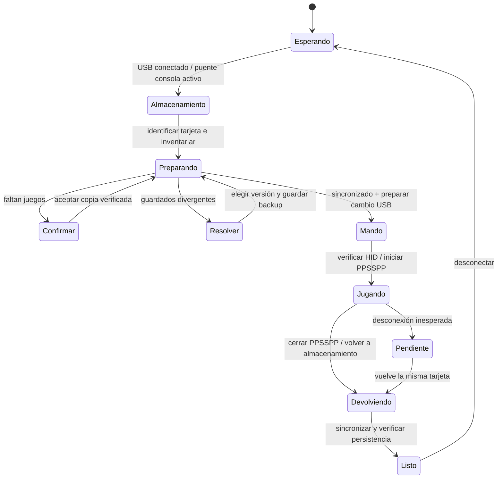

# Viabilidad y diseño · 31 de octubre de 2026

## Conclusión técnica

Es viable construir un dock de emulación con PSP como mando, biblioteca local y retorno de guardados. La experiencia de conectar y seguir jugando necesita software de consola adicional; Windows solo no puede convertir el almacenamiento USB oficial en un mando ni reanudar el estado vivo de un juego nativo en PPSSPP.

El USB no implica por sí mismo que sea imposible un dispositivo compuesto: la limitación verificada corresponde a **los modos y a FuSa examinados**, no a una demostración de imposibilidad del hardware.

## Evidencia consultada

| Fuente primaria | Qué demuestra | Qué no demuestra |
|---|---|---|
| [Manual Sony: conexión USB](https://manuals.playstation.net/document/en/psp/current/settings/usb.html) | Interfaz de almacenamiento compatible con PC. | Entrada de mando o órdenes de ejecución remota. |
| [Sony: carga USB](https://manuals.playstation.net/document/en/psp/current/settings/usbcharge.html) | Existencia de USB Auto Connect y comportamiento de carga. | Entrada automática desde cualquier juego ni cambio a FuSa. |
| [FuSa README](https://github.com/andy-man/psp-fusa-gamepad) | Homebrew HID, instalación en PSP/GAME, compatibilidad declarada CFW 3.80+, botones y ejes documentados. | Prueba de ARK-5/6.61 en esta PSP concreta. |
| [Descriptor FuSa](https://github.com/andy-man/psp-fusa-gamepad/blob/97a1fccb8cb561b14964de4d4dbab4fcd8618297/src/prx/usbhid.h) | En la revisión leída, una interfaz HID tanto en descriptor full-speed como high-speed; no interfaz mass storage. | Acceso simultáneo a Memory Stick. |
| [Inicialización FuSa](https://github.com/andy-man/psp-fusa-gamepad/blob/97a1fccb8cb561b14964de4d4dbab4fcd8618297/src/prx/usbhid.c) | Registro/arranque del driver HID y activación USB; código inspeccionado localmente. | Protocolo de control Windows para alternar automáticamente con almacenamiento. |
| [ARK-5 oficial](https://github.com/PSP-Arkfive/ARK-5) | Proyecto de firmware personalizado del entorno declarado por el usuario. | Compatibilidad de cada homebrew o plugin antiguo. |
| [PPSSPP: memoria Windows](https://www.ppsspp.org/docs/getting-started/save-data-and-storage-windows/) | Selección portable de memoria por `installed.txt`. | Que cualquier guardado concreto vaya a funcionar sin prueba. |
| [PPSSPP estable 1.20.4, Windows/main.cpp](https://github.com/hrydgard/ppsspp/blob/v1.20.4/Windows/main.cpp) | Lectura de `installed.txt` junto al ejecutable y destino alternativo si no hay escritura. | Soporte en esa versión de los flags nuevos de 1.21. |
| [Opciones PPSSPP](https://www.ppsspp.org/docs/reference/command-line/) y [descargas](https://www.ppsspp.org/download/) | Documentación distingue opciones 1.21/desarrollo de la estable descargable 1.20.4. | Que `--memstick` o `--resolution-scale` funcionen en la estable actual. El prototipo no los usa. |

FuSa fija PID 0x01CB en su código. Un VID/PID o el nombre de un mando por sí solo no bastan para declarar probado un mapeo PSP; hay que observar informes HID y contrastar cada entrada.

## UX objetivo sin pasos diarios en la consola

El prototipo implementa los estados de biblioteca, sincronización, ejecución PC y devolución pendiente. Las transiciones de modo USB de la consola del diagrama son **diseño pendiente**, no una función operativa oculta.

## Componente necesario en PSP

Propuesta de menor incertidumbre inicial: homebrew dedicado “Dock Bridge”, iniciado una vez para la sesión (más adelante autoinicio/plugin VSH bajo ARK-5). Secuencia almacenamiento → HID → almacenamiento, nunca dos escritores sobre FAT a la vez. Antes del cambio, cerrar archivos, verificar copias y esperar confirmación del PC. En PC, vaciar escrituras y desmontar el volumen de forma segura; no basta con que termine una copia de Python. Después, reenumerar HID, recuperar el foco del launcher y verificar entrada.

Hace falta una vía de órdenes fuera del almacenamiento puro. Candidatos a investigar en consola: canal USB de control dedicado o un homebrew que cierre almacenamiento y cambie de modo bajo un protocolo coordinado. Un archivo de órdenes en la Memory Stick mientras el PC posee el volumen **no se acepta como solución segura**, pues obliga a compartir el sistema de archivos montado. HID + interfaz de archivos mediante RPC propia es otra arquitectura posible; requiere driver/protocolo y pruebas, no está implementada.

Contrato propuesto de puente, todavía sin transporte ni implementación: `HELLO` con versión/capacidades y nonce; `PREPARE_CONTROLLER` tras sincronización; confirmación `STORAGE_RELEASED` tras desmontaje; reenumeración HID y verificación de informes; `RETURN_STORAGE` tras cerrar PPSSPP; reconexión de la misma tarjeta; `SYNC_COMPLETE` solo después de verificar. Órdenes idempotentes, timeout sin escribir, sesión vinculada a tarjeta y hash de manifiesto. Si el puente no responde se permanece en un estado visible y no se anuncia «listo para desconectar».

No se modifica flash, cIPL ni configuración de plugins durante este prototipo. FuSa puede servir para probar la entrada HID con una transición manual de laboratorio, pero no resuelve este protocolo de producto.

## Aceptación pendiente con la PSP-2003

1. Detectar una conexión física real y registrar tiempos de aparición/desaparición, tipo de unidad y estabilidad del identificador de tarjeta.
2. Inventariar juegos reales sin ejecutar actualizadores como si fueran juegos; comprobar ISO, CSO y un homebrew EBOOT con auxiliares. Evaluar PARAM.SFO/categorías para la versión de producto.
3. Copiar una partida de prueba y abrirla realmente en PPSSPP; guardar, cerrar y devolverla; comprobar que la PSP puede cargarla. Una igualdad de hashes no sustituye esta comprobación.
4. Arrancar FuSa en ARK-5/6.61, inspeccionar informes HID, probar cruceta, analógico, ocho botones de juego y control de salida; comprobar Gamepad API y DirectInput por separado.
5. Medir latencia y comportamiento con el juego ejecutándose, cambio de foco y retorno al launcher. Confirmar escala gráfica adecuada con GPU y juego reales.
6. Con un puente implementado: verificar vaciado/desmontaje, reenumeración, transición automática de vuelta y persistencia antes de desconectar. Probar desconexión en transferencia y escritura con datos desechables.
7. Solo después de esos resultados se puede aceptar el flujo «conectar y jugar» sin operaciones diarias en la consola y habilitar inicio de Windows si se desea.
